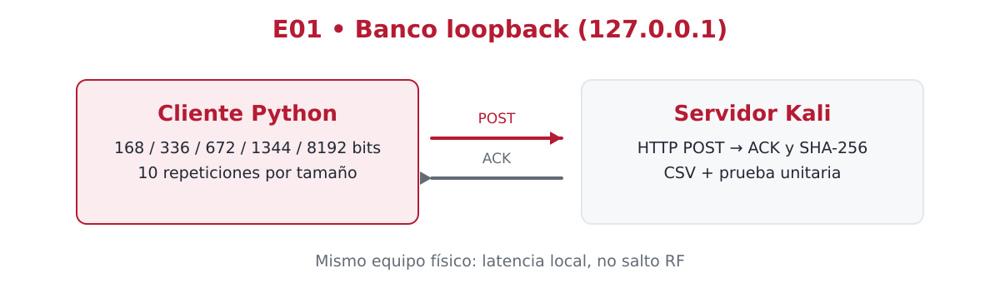
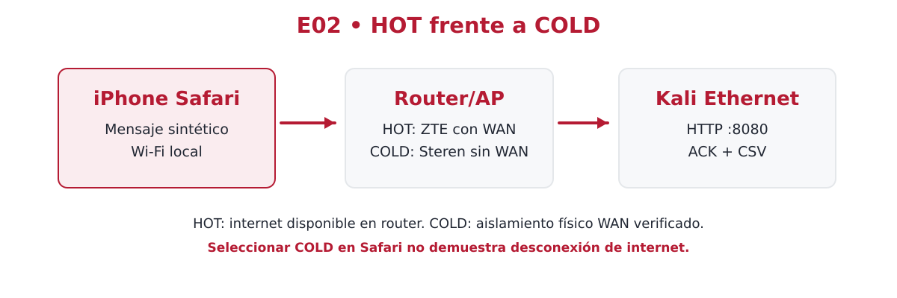
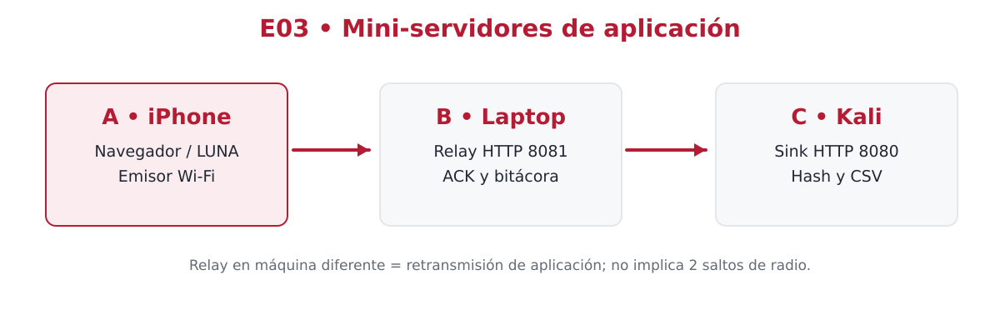
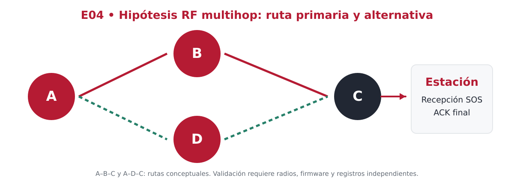
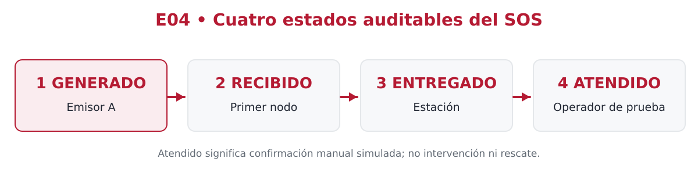

# SENTINEL / GEA Latido — E01 a E04

**Programa de investigación reproducible del 3er Foro de Investigación UVM (Ingeniería, Nivel 2, Ciclo 03-2026).**

**Autora:** Nailea Mitchel Falcon Triana · **Asesor:** Mtro. Carlos Guadarrama Ponce · **Campus:** En Línea · **Carrera:** Ingeniería en Tecnologías y Sistemas de Información.

**Meta científica de campo:** PDR ≥95 %, latencia SOS extremo a extremo <2.5 s, trazabilidad de cuatro fases y resiliencia al perder un nodo. Las metas no constituyen resultados ya medidos.

## Inicio rápido sin internet (Python 3.10+)

```bash
unzip SENTINEL_E01_E04_GitHub_Reproducible.zip
cd SENTINEL_E01_E04_GitHub_Reproducible
bash scripts/prepare_offline.sh
bash scripts/run_all_offline.sh
bash scripts/e01_loopback.sh
```

Un **solo `.venv`**, solo biblioteca estándar: no hay descargas `pip`. La carpeta `runs/` almacena los resultados generados. En Windows: `./scripts/prepare_offline.ps1` y `./scripts/run_all_offline.ps1`.

## Árbol de experimentos

| E | Ejecución y propósito | Tipo de evidencia |
|---|---|---|
| E01 | `bash scripts/e01_loopback.sh`: cargas en loopback | Loopback medido local |
| E02 | `legacy/e01_e02/server.py` + Safari Wi-Fi HOT/COLD y tcpdump | LAN y aislamiento verificable |
| E03 | `legacy/e03/code/gea_node.py` (B relay, C sink) | Relays en hardware distinto al probarlo; selftest localhost separado |
| E04 | `python -m sentinel.mesh_sim` + `python -m sentinel.verify_rf archivo.csv` | Simulación y protocolo de campo RF instrumental |

## Integridad de los datos

`./.venv/bin/python scripts/verify_data_integrity.py` contrasta el SHA-256 de cada CSV observado con el manifiesto `data/observados/SHA256SUMS.txt`. Con 50/50 entregas, el IC95 % Wilson es aproximadamente [92.87 %, 100 %]; no implica que el PDR poblacional sea al menos 95 % con 95 % de confianza.

## Resultados empíricos incluidos

`data/observados/e01_loopback_50.csv`: 50 de 50 paquetes aceptados en loopback Kali. `e02_hot_50_conciliados.csv`: 50 de 50 envíos Safari+ACK finales observados con recepción Kali y captura TCP documentada en el informe original. El CSV `e02_iphone_180_etiquetas.csv` conserva 180 filas, con etiquetas experimentales que **no son prueba física de WAN desconectada ni de mesh real**. Son resultados distintos a los de un radio de 915 MHz.

## E04: SOS y cuatro estados

`GENERADO → RECIBIDO → ENTREGADO → ATENDIDO_SIMULADO`. El receptor confirma entrega técnica; operador simulado confirma atención de laboratorio, no rescate. Radios LoRa/IEEE 802.15.4 no son intercambiables automáticamente. Los radios, firmwares, enlaces y autorización de campo deben fijarse antes de ensayar. Ver `docs/PROTOCOLO_EXPERIMENTAL.md`.

## Estructura

`legacy/e01_e02` preserva el software original de E01/E02; `legacy/e03` preserva v2 con alias LUNA y CRC32. `sentinel/uart_mesh.py` ofrece transporte físico UART opcional para radios transparentes (Linux/macOS); `sentinel/mesh_sim.py` modela rutas y fallos; `sentinel/analyze.py` recalcula métricas observadas; `sentinel/verify_rf.py` valida bitácoras de campo según plantilla. `scripts/generate_figures.py` recrea diagramas SVG. `reports/` contiene cartel e informe en PDF, cartel editable PPTX. `figures/` ofrece referencias visuales por experimento.

## Publicación y seguridad

Leer `docs/GITHUB_PUBLICACION.md`, `docs/PRIVACIDAD_ETICA.md` y `docs/CRITERIOS_1_A_12.md` y `docs/COMANDOS_DE_LABORATORIO_E01_E04.md` antes de `git push`. El servidor de laboratorio usa HTTP sin cifrado y paquetes sintéticos; **NO comunica a 911/C5**. La conservación NOM-151 solo se acredita mediante el procedimiento correspondiente con un PSC, no por generar un hash.

## Fuentes principales

INEGI ENDIREH 2021 (resultados 2022); IEEE 802.15.4-2020; Augustin et al. (2016), DOI 10.3390/s16091466; Shi et al. (2016), DOI 10.1109/JIOT.2016.2579198; Miranda et al. (2022), DOI 10.1109/JIOT.2022.3177256; Secretaría de Economía, NOM-151-SCFI-2016. Referencias detalladas en el informe.

**Licencia:** MIT para el software de investigación; materiales académicos y logotipos de UVM sujetos a las condiciones del titular respectivo.

## Figuras de referencia (SVG)







Para adaptar la transmisión física E04 a radios UART transparentes, consulta `docs/PROTOCOLO_EXPERIMENTAL.md` y el módulo `sentinel/uart_mesh.py`. Las pruebas por UART requieren radios compatibles; el transporte es diferente de un protocolo mesh auto-enrutado.
