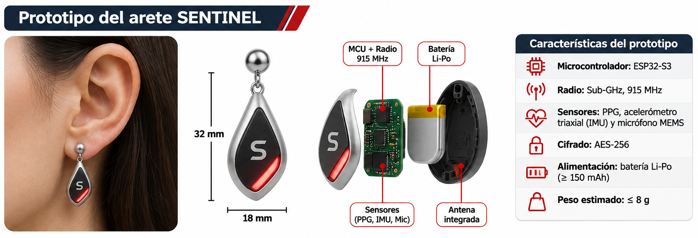
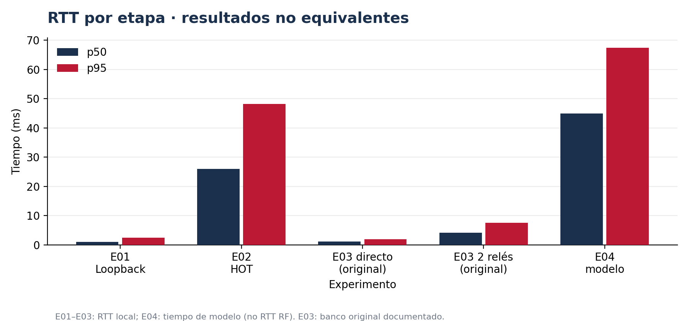
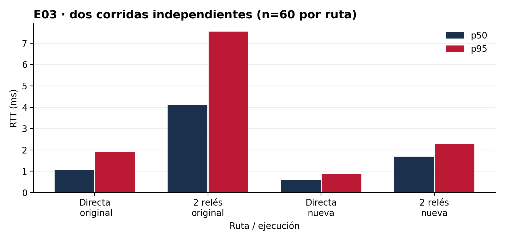
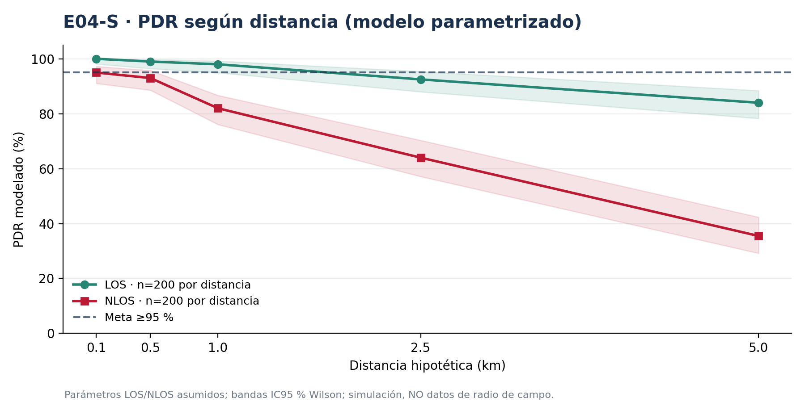
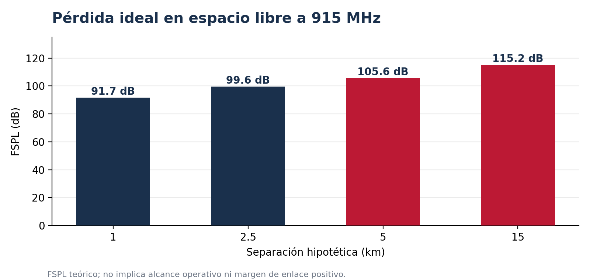

# SENTINEL

**Red comunitaria de alerta SOS: evaluación experimental E01–E04 y propuesta de transporte Sub-GHz a 915 MHz**

SENTINEL · Ingeniería, Nivel 2 · 3er Foro de Investigación UVM
Campus En Línea · Ciclo 03-2026 · Línea 2025-011
Autora: Nailea Mitchel Falcon Triana · Asesor: Mtro. Carlos Guadarrama Ponce
Repositorio: https://github.com/mitchelfalcon/Sentinel_E01_E04


**Versión de entrega:** 2026 · **Tipo de documento:** Informe general reproducible · **ODS:** 5, 9, 11, 16.

## Resumen

SENTINEL investiga una arquitectura de comunicación de alertas SOS que podría operar localmente sin que el dispositivo emisor disponga de conectividad celular. El programa E01–E04 separa pruebas HTTP/LAN (E01, E02 y E03), evaluación discreta de rutas (E04) y cálculo radioeléctrico teórico a 915 MHz. E01 y E02 registraron 50/50 entregas cada uno (RTT p50 de 1.05 y 26.00 ms). E03 documentó 60/60 confirmaciones por ruta en el banco original y una nueva corrida instrumentada confirmó 60/60 por ruta en localhost. E04, repetido con semilla 42, registró 97/100 entregas y una latencia modelada p50 de 44.96 ms y p95 de 67.48 ms. Un análisis paramétrico adicional LOS/NLOS examina tasas hipotéticas de pérdida según distancia. El estudio define metas de PDR ≥95 % y tiempo de generación a ACK final inferior a 2.5 s para una futura red física Sub-GHz, sin declarar tales metas verificadas en radio de campo. Se aporta código, CSV, pruebas, control SHA-256, protocolo de medición y escenario financiero piloto.

**Palabras clave:** alertas SOS; red multisalto; procesamiento en el borde; PDR; latencia; La Paz, Baja California Sur; reproducibilidad.

## 01. Problema, diagnóstico y delimitación

Como contexto estatal, el material estadístico aportado del Instituto Sudcaliforniano de las Mujeres refiere **6,869 llamadas al 911 por violencia contra las mujeres, 3,344 carpetas de investigación por violencia familiar y ocho feminicidios durante 2024** (estadísticas atribuidas a SESNSP, según la tabla institucional). Las proyecciones CONAPO 2026 incluidas en el mismo material reportan **163,291 mujeres en el municipio de La Paz**. Estas magnitudes describen contexto y población; no equivalen a prevalencia individual, cobertura celular ni duración de atención de emergencias.

**Delimitación:** Municipio de La Paz, Baja California Sur, con puntos urbanos, periurbanos y rurales propuestos. El diagnóstico de conectividad debe documentar **punto de medición, operador, fecha, cobertura útil, LOS/NLOS y disponibilidad energética**. No se calcula porcentaje local de puntos sin señal ni tiempo de respuesta mientras no existan recorridos instrumentados con denominador explícito.

**Pregunta:** ¿Puede una arquitectura con detección en el borde y transporte multisalto Sub-GHz a 915 MHz transmitir una alerta sintética hasta una estación comunitaria con integridad digital verificable, PDR ≥95 % y latencia menor de 2.5 s, sin requerir conectividad celular en el nodo de origen?

## 02. Objetivos, hipótesis e indicadores de éxito

**General.** Desarrollar y evaluar preliminarmente una arquitectura de alerta autónoma, mediante un banco de pruebas reproducible y una propuesta de red comunitaria Sub-GHz con procesamiento en el borde, para contrastar las metas de **PDR ≥95 %**, **latencia a ACK final <2.5 s** e integridad verificable de los mensajes SOS.

**Específicos.** (1) Diseñar el nodo portátil con PPG, acelerómetro triaxial y micrófono MEMS, y los nodos comunitarios. (2) Cuantificar las etapas E01–E04 registrando PDR, RTT p50/p95, n, IC95 % y disponibilidad de rutas. (3) Calcular FSPL a 915 MHz y definir pruebas RF futuras con RSSI/SNR, LOS/NLOS y consumo. (4) Definir la evaluación independiente del detector mediante sensibilidad, especificidad y falsos positivos. (5) Verificar secuencias y resúmenes SHA-256 en los mensajes de prueba.

**Hipótesis técnica.** Bajo condiciones de radio, tráfico y topología definidas, la retransmisión comunitaria con rutas alternativas puede facilitar la recepción de mensajes SOS locales independientemente de la red celular del emisor. La confirmación del objetivo de PDR y latencia requiere una campaña física RF, no solo pruebas HTTP ni simulación.

| Indicador | Meta | Interpretación y medición |
|---|---|---|
| PDR en campo RF | ≥95 % | ACK de estación / transmisiones, por condición; n e IC95 % Wilson |
| Latencia SOS RF | <2.5 s | Emisión de alerta a ACK final; p50, p95, n y relojes compatibles |
| Integridad | 100 % de paquetes aceptados íntegros | Secuencia, checksum de protocolo y SHA-256 |
| Resiliencia | Ruta alternativa documentada | Cambio de nodos ante fallo, trazas y tiempo de recuperación |
| Detector | Sensibilidad y falsos positivos medidos | Matriz TP/FP/TN/FN; objetivos numéricos por fijar antes del ensayo |
| Atención | Confirmación del operador | Estado independiente de ACK de recepción técnica |

## 03. Marco técnico y arquitectura

El enlace propuesto opera en la banda Sub-GHz de 915 MHz, con un transceptor y firmware **por seleccionar**. LoRa (modulación), LoRaWAN (protocolo de red) e IEEE 802.15.4 no se asumen equivalentes ni auto-enrutables por defecto. El funcionamiento multisalto requiere un protocolo de rutas, identificación de saltos, TTL, reintentos, seguridad y registro de ACK. La estación comunitaria recibe y conserva eventos; una eventual salida a una central de atención depende de acuerdo y canal autorizado.

**Flujo lógico:** `ALERTA GENERADA → NODO QUE RECIBE → ESTACIÓN ENTREGA/ACK → OPERADOR CONFIRMA`.

**Diseño conceptual del arete:** PPG, IMU triaxial, micrófono MEMS, MCU, radio Sub-GHz, batería y protección de energía. El render adjunto representa una hipótesis de diseño industrial; dimensiones, autonomía, tasa de detección y ergonomía no están medidas. El paquete de prueba mínimo es de **168 bits / 21 bytes**; no se confunde con 168 bytes.

{width=75%}

## 04. Materiales y metodología

**Enfoque:** cuantitativo, pruebas computacionales y HTTP/LAN realizadas; escenarios RF de campo propuestos. **Equipamiento documentado:** iPhone 17 con Safari como emisor E02; estación Kali Linux, laptop para procesos de retransmisión, equipo de red ZTE y Steren COM-852. Ninguno de estos routers constituye un enlace físico Sub-GHz de 915 MHz.

| Etapa | Tamaño muestral y condiciones | Fuente y magnitud |
|---|---|---|
| E01 | n=50; cinco longitudes de carga, 10 por longitud; loopback Kali | CSV observado, RTT HTTP y ACK |
| E02 HOT | n=50; Safari iPhone, Wi-Fi, ZTE, Kali Ethernet | CSV conciliado, RTT HTTP y ACK |
| E03 original | n=60 por configuración; directa o dos relés de software | Informe original, RTT HTTP/localhost |
| E03 repetición | n=60 por configuración; 6 cargas × 10 repeticiones | CSV ejecutado en este entorno, RTT HTTP/localhost |
| E04 rutas | n=100; ruta principal 50, ruta alternativa 50; semilla 42 | Modelo discreto; pérdidas/tiempos parametrizados |
| E04-S distancias | 2 condiciones × 5 distancias × n=200 = 2,000 envíos modelados | Sensibilidad LOS/NLOS hipotética, semilla 20261123 |

**Variables independientes:** escenario, tamaño de carga, rutas, número de relés, distancia y LOS/NLOS. **Dependientes:** confirmación/entrega (PDR), RTT o latencia modelada según etapa, p50, p95, tasa de pérdida, integridad, recuperación de ruta; en campo se sumarán RSSI/SNR, corriente, energía y detección. **Reloj:** RTT por `monotonic`/`performance.now()`; medir ida sin retorno exige sincronización y cuantificación de error. **Análisis:** estadística descriptiva, percentiles interpolados, intervalo binomial Wilson al 95 %, FSPL teórico y matriz de confusión futura.

**Protocolo de datos y ética:** eventos SOS sintéticos, alias ficticio, sin víctimas ni llamada real a emergencias. Toda evaluación con personas adultas o datos biométricos requiere consentimiento informado, minimización, cifrado y revisión de privacidad. SHA-256 permite detectar cambios respecto al resumen de referencia; no equivale por sí solo a firma digital ni a identidad de quien generó el mensaje.

## 05. Resultados experimentales y procedencia

### 05.1 Resumen principal E01–E04

| Ensayo | n / confirmados | PDR | p50 (ms) | p95 (ms) | Tipo de fuente |
|---|---|---|---:|---:|---|
| E01 loopback | 50 / 50 | 100 % | 1.05 | 2.50 | Observado; CSV original reanalizado |
| E02 HOT | 50 / 50 | 100 % | 26.00 | 48.20 | Observado; CSV original reanalizado |
| E03 directo (original) | 60 / 60 | 100 % | 1.07 | 1.90 | Informe del banco original |
| E03 dos relés (original) | 60 / 60 | 100 % | 4.11 | 7.54 | Informe del banco original |
| E04 modelo rutas | 100 / 97 | 97 % | 44.96 | 67.48 | Modelo discreto reproducido, semilla 42 |

Los valores E01–E03 son RTT computacionales/HTTP; los de E04 son tiempo de entrega **modelado**, no RTT observado por radio. En E01/E02 la tabla se recalculó con archivos originales incluidos en `data/observados/`, no mediante repetición física de los dispositivos.

{width=90%}

### 05.2 Repetición E03 instrumentada

Una nueva ejecución local realizó **120 solicitudes** con cargas de 168, 336, 672, 1344, 8192 y 32768 bits (10 por carga y por configuración); ACK y SHA-256 verificados. La corrida documentó:

| Ruta de software | Confirmados | RTT p50 | RTT p95 | IC95 % Wilson de PDR |
|---|---:|---:|---:|---|
| Directa | 60/60 | 0.614 ms | 0.883 ms | 93.98–100 % |
| Dos relés | 60/60 | 1.683 ms | 2.265 ms | 93.98–100 % |

El cambio de equipo/sistema operativo explica que esta **repetición** no reproduzca los RTT exactos del banco original; ambos registros se publican sin sustituirse mutuamente.

{width=88%}

### 05.3 E04: modelo reproducible de rutas y fallo

El programa `sentinel.mesh_sim` ejecutado con `--seed 42 --count 100 --fail-after 50` entrega **97/100 (97 %)**, p50 **44.96 ms** y p95 **67.48 ms** entre las 97 alertas entregadas. La ruta primaria `A>B>C` confirma 49/50; cuando B se deshabilita, la ruta alternativa `A>D>C` confirma 48/50. Los estados registrados son **GENERADO, RECIBIDO, ENTREGADO y ATENDIDO_SIMULADO**: este último no prueba intervención humana real.

**Intervalos Wilson:** 50/50 corresponde a IC95 % **92.87–100 %**; 60/60 a **93.98–100 %**; 97/100 a **91.55–98.97 %**. La estimación puntual del 100 % en muestras pequeñas no garantiza una tasa poblacional ≥95 %.

### 05.4 E04-S: sensibilidad a distancia LOS/NLOS (modelo adicional)

Se ejecutó un barrido discreto de **2,000 eventos sintéticos** (200 por cada combinación de 5 distancias y 2 condiciones). Las probabilidades fueron **supuestos del experimento computacional**, no observaciones ni calibraciones de radio. Se publican los 2,000 eventos, la semilla y las probabilidades en `evidence/ejecucion_reproducida_2026/`.

| Distancia | LOS: PDR modelado | NLOS: PDR modelado | n por condición |
|---|---:|---:|---:|
| 0.1 km | 100.0 % | 95.0 % | 200 + 200 |
| 0.5 km | 99.0 % | 93.0 % | 200 + 200 |
| 1 km | 98.0 % | 82.0 % | 200 + 200 |
| 2.5 km | 92.5 % | 64.0 % | 200 + 200 |
| 5 km | 84.0 % | 35.5 % | 200 + 200 |

{width=90%}

### 05.5 Presupuesto de enlace a 915 MHz (teórico)

La pérdida en espacio libre se calcula mediante `FSPL(dB) = 32.44 + 20 log10(distancia_km) + 20 log10(915)`.

| Distancia | FSPL ideal a 915 MHz | Margen de enlace simbólico |
|---|---:|---|
| 1 km | 91.7 dB | PTx + GTx + GRx − 91.7 − Ladicional − SRx |
| 2.5 km | 99.6 dB | PTx + GTx + GRx − 99.6 − Ladicional − SRx |
| 5 km | 105.6 dB | PTx + GTx + GRx − 105.6 − Ladicional − SRx |
| 15 km | 115.2 dB | PTx + GTx + GRx − 115.2 − Ladicional − SRx |

PTx y SRx están expresados en dBm; ganancias en dBi; las pérdidas en dB. **Margen = PTx + GTx + GRx − FSPL − pérdidas adicionales − sensibilidad del receptor (dBm).** El valor numérico depende del modelo de transceptor, potencia, ganancias, modulación, pérdidas y altura/polarización de antenas. **15 km es una distancia para cálculo teórico, no alcance comprobado.**

{width=85%}

## 06. Discusión y limitaciones

Las pruebas E01 y E02 permiten cuantificar las diferencias de RTT entre loopback y Wi-Fi/LAN; E03 prueba la sobrecarga de dos procesos retransmisores, y su repetición independiente confirma el efecto de más etapas en un mismo entorno. E04 muestra que una ruta alternativa puede conservar entregas tras inhabilitar un nodo en **un modelo definido por parámetros**. No existe inferencia válida desde ese resultado a rendimiento de LoRa físico ni a rescate oportuno. El ACK de estación es recepción técnica; la confirmación de un operador es un estado posterior que debe medirse por separado.

**Limitaciones:** aún no se dispone de radios seleccionados, medición en campo de RSSI/SNR, mapa instrumentado de cobertura, consumo y autonomía de arete, ni evaluación con matriz de confusión del clasificador. No se ha documentado enlace operativo con C5/911 ni permisos de instalación. La simulación E04-S es una sensibilidad matemática; las funciones de probabilidad se escogieron ex ante y no se ajustaron a datos medidos. Las metas **PDR ≥95 %, tiempo <2.5 s y detector autónomo fiable** continúan como criterios de ensayo y no como rendimiento demostrado de campo. No se presentan como resultados las cifras antiguas 98.4 %, 2.41 s, 15 km operativos, 72 h de autonomía ni 32–45 mA, por carecer aquí de validación experimental física.

## 07. Comparación y aplicación

| Factor | Aplicación móvil | Botón celular | SENTINEL propuesto |
|---|---|---|---|
| Transporte | Wi-Fi o red celular | 4G/5G u otra red del proveedor | Red comunitaria RF Sub-GHz local |
| Activación | Manual o software | Manual / según producto | Diseño de detección local + SOS |
| Dependencia celular del origen | Frecuente | Frecuente | No requerida en tramo radio proyectado |
| Confirmación | Según servicio | Según servicio | ACK estación y operador como estados separados |
| Integridad | Variable entre proveedores | Variable entre proveedores | Secuencia y hash SHA-256 propuestos |
| Estado de validación | Producto según proveedor | Producto según proveedor | Software ensayado; radio y detector aún por validar |

**Aplicación potencial:** piloto con dispositivos portátiles, relés comunitarios y estación en puntos de La Paz, sujeto a permisos, diagnóstico RF y acuerdo de un aliado. Los emplazamientos en luminarias/semáforos son hipótesis de instalación y no permisos concedidos. El video demostrativo de 60 segundos está **previsto para publicarse en GitHub**; el QR solo identifica el repositorio.

## 08. Evaluación del detector, integridad y ética

La matriz de confusión `TP, FP, TN, FN` permitirá reportar **sensibilidad = TP/(TP+FN)** y **tasa de falsos positivos = FP/(FP+TN)**, indicando n y contexto. No se asignan valores antes de recolectar señales etiquetadas con protocolo ético. No se usan alertas reales ni testimonios sensibles en el repositorio público; la posible detección acústica y biométrica deberá minimizar captura y retención. Se recomienda cifrado de extremo a extremo con administración de claves al implementar hardware, independiente de la comprobación de integridad SHA-256.

## 09. Estimación financiera del piloto

Escenario de planeación México 2026, MXN, antes de IVA y **sin cotizaciones vigentes**:

| Unidad o rubro | Cantidad | Costo unitario | Subtotal |
|---|---:|---:|---:|
| Portátil conceptual | 5 | $1,900 | $9,500 |
| Relé autónomo | 3 | $4,250 | $12,750 |
| Pasarela comunitaria | 1 | $4,650 | $4,650 |
| Instrumentación | 1 | $3,000 | $3,000 |
| Ingeniería no recurrente | 1 | $34,000 | $34,000 |
| Instalación de relés | 3 | $650 | $1,950 |
| Instalación de pasarela | 1 | $950 | $950 |
| **CAPEX del piloto** | | | **$66,800 MXN** |

OPEX mensual estimado: **$2,140 MXN**; horizonte de 36 meses: **TCO $143,840 MXN**, sin reserva; reserva opcional 10 % CAPEX: $6,680 MXN. Un proyecto sin enlace externo de datos opcional reduce OPEX paramétrico a $1,790 MXN/mes. Estos costos no acreditan cobertura, autorización regulatoria ni contratación de servicio público.

## 10. Respuestas a las 12 observaciones del jurado

| N.º | Solicitud | Incorporación corregida y evidencia |
|---|---|---|
| 01 Problema | Diagnóstico de La Paz por operador, punto, fecha, cobertura, LOS/NLOS, energía | Tabla de campo definida; cero porcentajes locales no medidos; contexto SESNSP 2024 |
| 02 Objetivos | PDR ≥95 %, latencia <2.5 s, detector | Metas por etapa, n, p50/p95, IC95 % y matriz TP/FP/TN/FN por completar |
| 03 Teoría | Antecedentes recientes LPWAN/seguridad wearable | Distinción LoRa/LoRaWAN/802.15.4; referencias a Bindi y estudios de malla LoRa |
| 04 Metodología | Modelos, n, sitios, distancias, relojes, consentimiento | Hardware iPhone 17/laptop/Kali/ZTE/Steren; n especificados, RTT monótono y protocolo ético |
| 05 Resultados | n, origen, PDR-distancia, latencias | CSV E01/E02, E03 original y repetición, E04 semilla 42, E04-S paramétrico y gráficas |
| 06 Aplicación | Código, fotografía, QR, video | Scripts, pruebas, GitHub y render **conceptual**; video por publicar, sin foto fingida |
| 07 Análisis | IC95 %, enlace, matriz de confusión | Wilson, FSPL 915 MHz y diseño TP/FP/TN/FN; radio y detector pendientes |
| 08 Problema real | Respaldo de aliado comunitario/institución | Actores propuestos; no declarar convenio ni interconexión con C5/911 |
| 09 Impacto | Costo por nodo, piloto, escalamiento | 5 portátiles +3 relés +1 pasarela; CAPEX 66,800; OPEX 2,140/mes |
| 10 Originalidad | Comparación con alternativas y Bindi | Aporte de integración y auditoría de estados; no se atribuye inventar sensores ni LoRa |
| 11 Visual | Cartel legible con tablas, gráfica y QR | Figuras vectoriales y PNG, sin cifras no verificadas; reproducción de PDF imprimible |
| 12 Exposición | Video 60 s y respuestas a limitaciones | Guion GitHub de 60 s, distinción FSPL/alcance, ACK/atención y pruebas pendientes |

## 11. Conclusiones / aplicación

- **Resultados preliminares:** E01–E03 obtuvieron 100 % de confirmaciones en las muestras de software reportadas; la simulación E04 logró **97/100** (97 %) con p95 de **67.48 ms**. No son pruebas de una malla RF en campo.
- **Aplicación:** se propone un piloto en La Paz, Baja California Sur, con estaciones comunitarias y nodos autorizados tras reconocimiento territorial e institucional.
- **Aporte novedoso:** propuesta de integración de activación autónoma, red local sin dependencia celular en el origen y verificación de secuencia/hash con cuatro estados de seguimiento diferenciados.
- **Siguiente fase:** seleccionar radios 915 MHz y antenas, medir RSSI/SNR, PDR, latencia, consumo, alcance y LOS/NLOS; ensayar detector con consentimientos y validar alianzas y costos.

## 12. Guía reproducible y fuentes del expediente

**Comandos comprobados:**

```bash
bash scripts/prepare_offline.sh
bash scripts/run_all_offline.sh
python -m sentinel.analyze --out runs/estadisticas_observadas.json
python -m sentinel.mesh_sim --seed 42 --count 100 --fail-after 50 --output runs/e04_simulacion.csv
python -m sentinel.distance_model --seed 20261123 --n 200 --output-dir runs/e04_sensibilidad
python scripts/benchmark_e03_local.py --output-dir runs/e03_repeticion
python scripts/verify_data_integrity.py
```

**Datos fuente:** `data/observados/e01_loopback_50.csv`, `e02_hot_50_conciliados.csv`, informe académico E01–E04 (apartados de E03, E04 y presupuesto), capturas estadísticas aportadas de ISMujeres/SESNSP 2024 y CONAPO 2026. Los datos de ejecución se entregan congelados con hashes SHA-256 en `evidence/ejecucion_reproducida_2026/`. E03 original no incluye aquí los 120 registros crudos históricos; los 120 registros nuevos se entregan íntegros, separados.

**Bibliografía fundamental (verificar datos bibliográficos en la versión editorial definitiva):**

- Augustin, A., Yi, J., Clausen, T., & Townsley, W. (2016). A study of LoRa: Long range & low power networks for the Internet of Things. *Sensors, 16*(9), 1466. https://doi.org/10.3390/s16091466
- IEEE. (2020). *IEEE Std 802.15.4-2020: IEEE standard for low-rate wireless networks*.
- Material de investigación SENTINEL, informes y registros E01–E04 (2026), expediente académico UVM.
- Instituto Sudcaliforniano de las Mujeres, cuadro estadístico compartido con referencias a SESNSP 2024 y proyección CONAPO 2026.
- Literatura de referencia en el expediente: Bindi (2022), estudios sobre malla LoRa (2024–2025). Las referencias completas y DOI deben conservarse con el PDF de cada publicación correspondiente.

