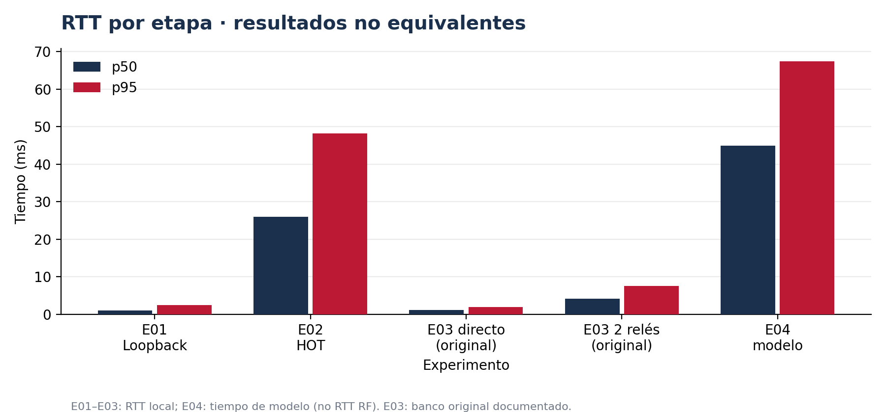
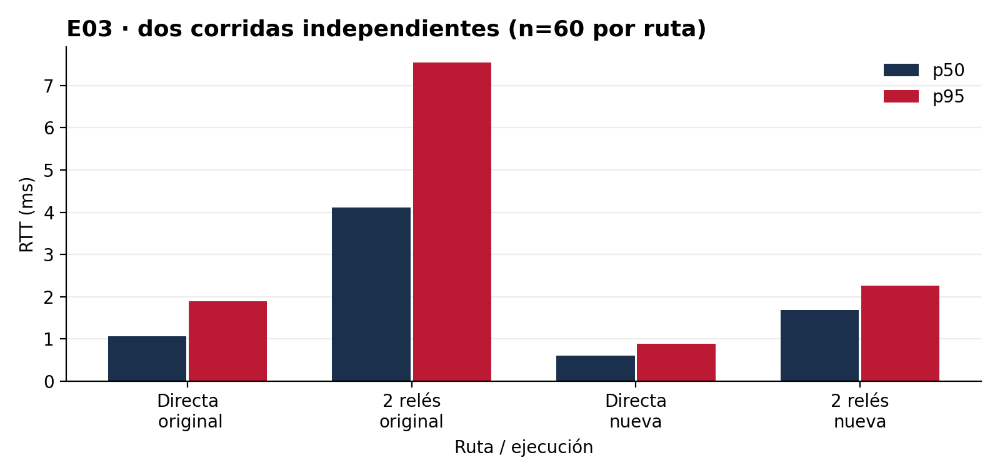
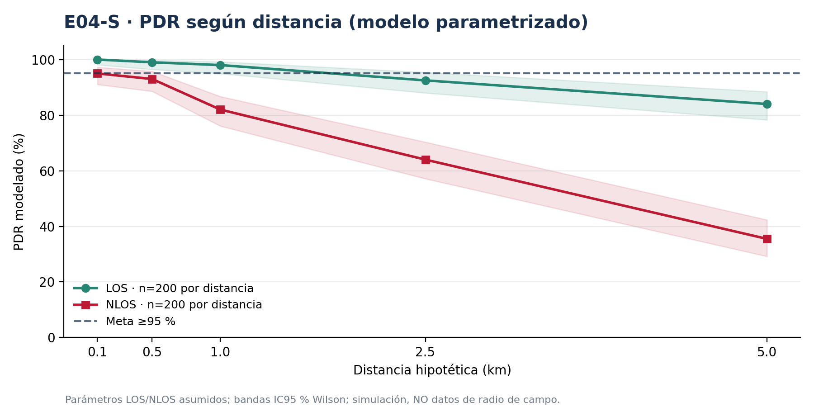
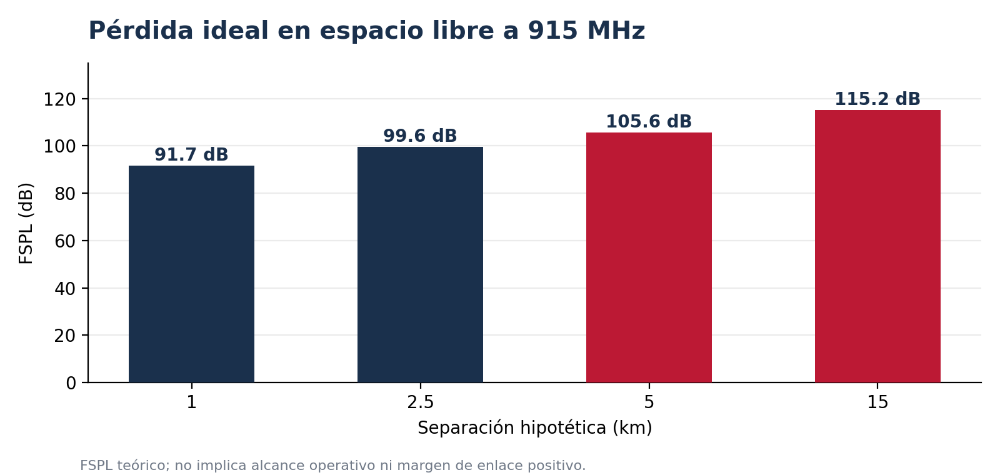

# Resultados observados, modelo y ejecución

## 05. Resultados experimentales y procedencia

### 05.1 Resumen principal E01–E04

| Ensayo | n / confirmados | PDR | p50 (ms) | p95 (ms) | Tipo de fuente |
|---|---|---|---:|---:|---|
| E01 loopback | 50 / 50 | 100 % | 1.05 | 2.50 | Observado; CSV original reanalizado |
| E02 HOT | 50 / 50 | 100 % | 26.00 | 48.20 | Observado; CSV original reanalizado |
| E03 directo (original) | 60 / 60 | 100 % | 1.07 | 1.90 | Informe del banco original |
| E03 dos relés (original) | 60 / 60 | 100 % | 4.11 | 7.54 | Informe del banco original |
| E04 modelo rutas | 100 / 97 | 97 % | 44.96 | 67.48 | Modelo discreto reproducido, semilla 42 |

Los valores E01–E03 son RTT computacionales/HTTP; los de E04 son tiempo de entrega **modelado**, no RTT observado por radio. En E01/E02 la tabla se recalculó con archivos originales incluidos en `data/observados/`, no mediante repetición física de los dispositivos.

{width=90%}

### 05.2 Repetición E03 instrumentada

Una nueva ejecución local realizó **120 solicitudes** con cargas de 168, 336, 672, 1344, 8192 y 32768 bits (10 por carga y por configuración); ACK y SHA-256 verificados. La corrida documentó:

| Ruta de software | Confirmados | RTT p50 | RTT p95 | IC95 % Wilson de PDR |
|---|---:|---:|---:|---|
| Directa | 60/60 | 0.614 ms | 0.883 ms | 93.98–100 % |
| Dos relés | 60/60 | 1.683 ms | 2.265 ms | 93.98–100 % |

El cambio de equipo/sistema operativo explica que esta **repetición** no reproduzca los RTT exactos del banco original; ambos registros se publican sin sustituirse mutuamente.

{width=88%}

### 05.3 E04: modelo reproducible de rutas y fallo

El programa `sentinel.mesh_sim` ejecutado con `--seed 42 --count 100 --fail-after 50` entrega **97/100 (97 %)**, p50 **44.96 ms** y p95 **67.48 ms** entre las 97 alertas entregadas. La ruta primaria `A>B>C` confirma 49/50; cuando B se deshabilita, la ruta alternativa `A>D>C` confirma 48/50. Los estados registrados son **GENERADO, RECIBIDO, ENTREGADO y ATENDIDO_SIMULADO**: este último no prueba intervención humana real.

**Intervalos Wilson:** 50/50 corresponde a IC95 % **92.87–100 %**; 60/60 a **93.98–100 %**; 97/100 a **91.55–98.97 %**. La estimación puntual del 100 % en muestras pequeñas no garantiza una tasa poblacional ≥95 %.

### 05.4 E04-S: sensibilidad a distancia LOS/NLOS (modelo adicional)

Se ejecutó un barrido discreto de **2,000 eventos sintéticos** (200 por cada combinación de 5 distancias y 2 condiciones). Las probabilidades fueron **supuestos del experimento computacional**, no observaciones ni calibraciones de radio. Se publican los 2,000 eventos, la semilla y las probabilidades en `evidence/ejecucion_reproducida_2026/`.

| Distancia | LOS: PDR modelado | NLOS: PDR modelado | n por condición |
|---|---:|---:|---:|
| 0.1 km | 100.0 % | 95.0 % | 200 + 200 |
| 0.5 km | 99.0 % | 93.0 % | 200 + 200 |
| 1 km | 98.0 % | 82.0 % | 200 + 200 |
| 2.5 km | 92.5 % | 64.0 % | 200 + 200 |
| 5 km | 84.0 % | 35.5 % | 200 + 200 |

{width=90%}

### 05.5 Presupuesto de enlace a 915 MHz (teórico)

La pérdida en espacio libre se calcula mediante `FSPL(dB) = 32.44 + 20 log10(distancia_km) + 20 log10(915)`.

| Distancia | FSPL ideal a 915 MHz | Margen de enlace simbólico |
|---|---:|---|
| 1 km | 91.7 dB | PTx + GTx + GRx − 91.7 − Ladicional − SRx |
| 2.5 km | 99.6 dB | PTx + GTx + GRx − 99.6 − Ladicional − SRx |
| 5 km | 105.6 dB | PTx + GTx + GRx − 105.6 − Ladicional − SRx |
| 15 km | 115.2 dB | PTx + GTx + GRx − 115.2 − Ladicional − SRx |

PTx y SRx están expresados en dBm; ganancias en dBi; las pérdidas en dB. **Margen = PTx + GTx + GRx − FSPL − pérdidas adicionales − sensibilidad del receptor (dBm).** El valor numérico depende del modelo de transceptor, potencia, ganancias, modulación, pérdidas y altura/polarización de antenas. **15 km es una distancia para cálculo teórico, no alcance comprobado.**

{width=85%}

